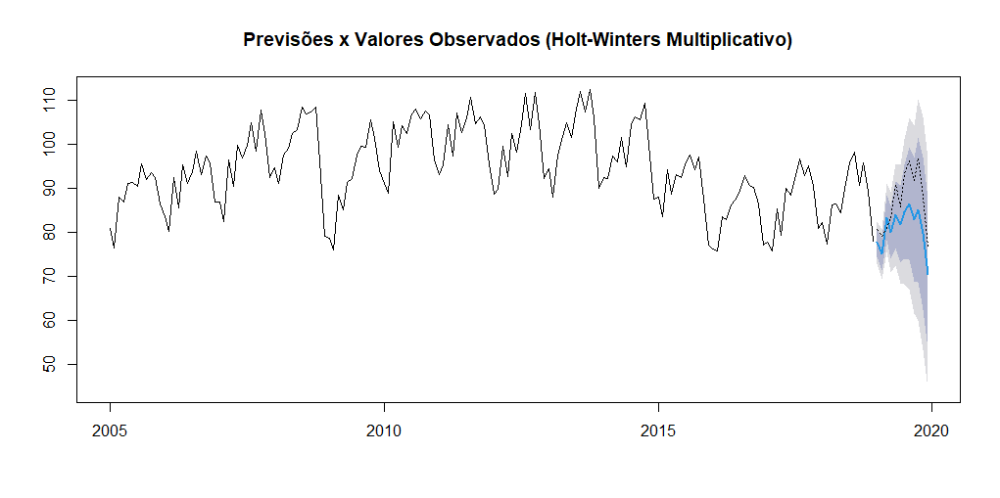

# 📈 Análise de Séries Temporais e Previsão do IPCA em R

Este repositório reúne o código em R e os gráficos gerados no estudo prático de modelagem e previsão da série histórica do **IPCA (Índice Nacional de Preços ao Consumidor Amplo)**, abrangendo o período de janeiro de 2005 a dezembro de 2019 (com treino até dezembro de 2018 e validação para os 12 meses de 2019).

---

## 🛠️ Tecnologias e Pacotes Utilizados
* **Linguagem R** (RStudio)
* **Pacote `forecast`** (suavização exponencial e previsões)
* **Pacote `stats`** (séries temporais e janelas)

---

## 📂 Ficheiros do Projeto
* [`series_temporais_ipca.R`](series_temporais_ipca.R) — Script principal com o código da análise.
* **Gráficos (`.png`):**
  * `Amortecimento Exponencial (com constante de amortecimento = 0,8).png`
  * `Amortecimento Exponencial (incluindo a determinação do a ).png`
  * `Método de Holt (incluindo a determinação dos parâmetros alpha e beta).png`
  * `Método de Holt-Winters (incluindo a determinação dos parâmetros dos parâmetros).png`
  * `holt_winters_multiplicativo.png`

---

## 📊 Gráficos e Modelos

### 1. Amortecimento Exponencial Simples ($\alpha = 0,8$)
.png)

### 2. Amortecimento Exponencial Simples (com determinação de $\alpha$)
.png)

### 3. Método de Holt ($\alpha$ e $\beta$)
.png)

### 4. Método de Holt-Winters
.png)

### 5. Holt-Winters Multiplicativo


---

## 🚀 Como Executar
1. Tenha o **R** e o **RStudio** instalados.
2. Instale o pacote `forecast` caso ainda não o tenha:
   ```R
   install.packages("forecast")
